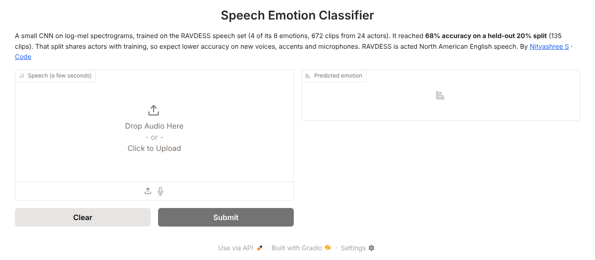
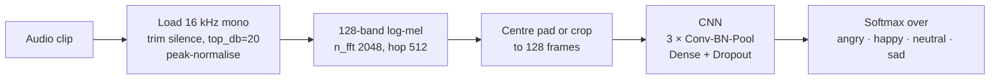

# Speech Emotion Classifier

**Live demo:** Hugging Face Space, being set up (the files are ready in [`space/`](space/), see [Deploy](#deploy-to-hugging-face-spaces)) · by [Nityashree S](https://nityashree.in)

Classifies a short clip of speech as **angry, happy, neutral or sad** with a small convolutional network over log-mel spectrograms, trained on the [RAVDESS](https://zenodo.org/record/1188976) speech set.



## What it does and why

Tone carries information that a transcript loses, which matters for call-centre analytics, voice assistants and accessibility tools. This project is a compact end-to-end example: audio preprocessing, two models compared on the same split (a random-forest baseline on MFCC statistics and a CNN on spectrograms), and a demo that runs the trained CNN.

## Results (from the training notebook)

4 of RAVDESS's 8 emotions, 672 clips from 24 actors, stratified 80/20 split (135 test clips):

| Model | Input | Test accuracy | Macro F1 |
|---|---|---|---|
| Random forest (200 trees) | 40 MFCC means + 40 standard deviations | 71.1% | 0.69 |
| CNN (3 conv blocks, 1.07 M parameters) | 128 × 128 log-mel spectrogram | 68.1% | 0.65 |

The CNN is the model in the demo (`best_mel_cnn.h5`), saved at its best validation accuracy. On this small dataset the simpler baseline scored slightly higher. Both are weakest on *neutral* (recall 0.37 to 0.47), which has half as many clips as the other classes.

## How it works



`emotion.py` holds the inference code, written to match the notebook's preprocessing step for step; `app.py` is the Gradio demo and `streamlit_app.py` a Streamlit version of it.

## Run it

```bash
pip install -r requirements.txt
python app.py                    # Gradio demo on http://127.0.0.1:7860
# or
streamlit run streamlit_app.py
```

To retrain, open `ravdess_training.ipynb`; its first cell downloads RAVDESS (about 215 MB) from Zenodo.

## Fixed on 2026-11-13

- **The demo reported the wrong emotion.** The Streamlit app mapped outputs as `{0: neutral, 1: happy, 2: sad, 3: angry}`, but the notebook's `LabelEncoder` sorts classes alphabetically, `{0: angry, 1: happy, 2: neutral, 3: sad}`. A model output of *angry* was shown as *neutral*, *neutral* as *sad* and *sad* as *angry*. `emotion.py` now uses the training order.
- **Preprocessing did not match training.** The app trimmed silence with librosa's default `top_db=60`; training used `top_db=20`. It now uses 20.
- Each upload is written to its own temporary file (all users shared `temp.wav`), and the model is loaded once instead of on every prediction.

## Known limitations

- **Speaker overlap.** The split is by clip, not by actor, so test clips come from actors the model heard in training. Accuracy on new speakers is likely lower; an actor-held-out split would measure it.
- **Small, acted data.** 672 clips of two sentences read by 24 North American actors. Spontaneous speech, other accents, noise and phone microphones are outside what it saw.
- **No test suite.** The notebook records the evaluation; the inference code was checked by loading the model and running a synthetic clip (output shape and probabilities summing to 1), not against labelled audio.
- **4 classes only.** Calm, fearful, disgust and surprised were dropped to keep the task balanced and small.

## Deploy to Hugging Face Spaces

Free, CPU-only. In a browser:

1. Sign in at [huggingface.co](https://huggingface.co) and choose **New → Space**. Name it `speech-emotion-classifier`, SDK **Gradio**, hardware **CPU basic (free)**, visibility **Public**.
2. In the Space's **Files** tab choose **Add file → Upload files** and upload: `app.py`, `emotion.py`, `best_mel_cnn.h5`, and from `space/` both `README.md` and `requirements.txt` (they replace the Space's defaults).
3. Wait for the build (a few minutes for TensorFlow). The Space is then live at `https://huggingface.co/spaces/<your-username>/speech-emotion-classifier`.
4. Replace the "being set up" line at the top of this README with that link.

---

Built by [Nityashree S](https://nityashree.in) · [GitHub](https://github.com/Nityaa08)
